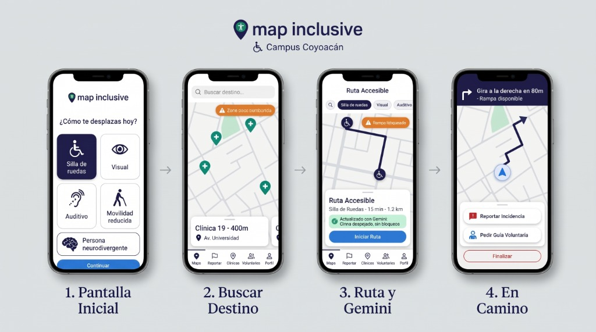

Enlace a la APP descargable en android

https://map-inclusive-coyoacan.netlify.app/

# Map Inclusive — Prueba Corta (100% Python + Android con Flet + Gemini API)

**Equipo:** Apex soa (Márquez Fuentes Sebastian, Calderón Pérez Emiliano Javier, Nelson Alejandro Gonzalez Al Daoud)  
**Campus:** Coyoacán  
**Stack de esta prueba:** **100% Python** (FastAPI + Flet para Android con motor Flutter + Google Gemini API). **Sin nada de Java.**



---

## Arquitectura (100% Python · Cero Java)

```text
[App Móvil Android — mobile_app/ (100% Python con Flet / motor Flutter)]
     │  HTTP JSON (actualización automática cada 10 min)
     ▼
[Backend Python — backend/ (FastAPI)]
     │  SDK oficial google-genai >= 3.5.0 (Interactions API)
     ▼
[Google Gemini (gemini-4-hydrogen + Google Search Grounding + Structured Output)]
```

### Funcionalidad de Gemini API integrada

1. **Monitor de Entorno Urbano cada 10 minutos (`POST /api/v1/environment-check`):**
   - Usa **`gemini-4-hydrogen`** mediante `client.interactions.create(...)` con **Google Search Grounding** (`{"type": "google_search"}`) y **Structured Output** (`response_format` JSON Schema).
   - Recopila clima, bloqueos viales/peatonales, transporte fuera de servicio, incidencias de accesibilidad y zonas de riesgo; adapta las recomendaciones a los 5 perfiles (`silla_de_ruedas`, `visual`, `auditivo`, `movilidad_reducida` y `neurodivergente`).
   - Incluye **caché de 10 minutos (600 s)** y **manejo sin conexión (`offline_demo`)** cuando no hay API key o internet.
2. **Clasificación rápida de incidencias ciudadanas (`POST /api/v1/incidents`):**
   - Al reportar un obstáculo desde la Pantalla 4 (*"Rampa bloqueada"*), Gemini evalúa la severidad (`bajo` | `medio` | `alto`), genera un consejo inmediato y actualiza la siguiente consulta de ruta.

---

## 1. Levantar el backend Python + Gemini

```bash
cd backend
python3 -m venv .venv
source .venv/bin/activate   # En Windows: .venv\Scripts\activate
pip install -r requirements.txt

# Opcional: agrega tu GEMINI_API_KEY (si no la pones, funciona en modo offline_demo)
cp .env.example .env

# Prueba rápida por terminal (1 consulta)
python3 quick_test.py --profile silla_de_ruedas

# Levantar servidor FastAPI en el puerto 8000
uvicorn main:app --host 0.0.0.0 --port 8000 --reload
```

---

## 2. Ejecutar la app móvil en Android (100% Python con Flet, sin Java)

Instala las dependencias de la app móvil:
```bash
pip install -r mobile_app/requirements.txt
```

### Opción A — Probar directo en tu teléfono Android (más rápido para el hackathon)
1. Instala la app gratuita **Flet** desde Google Play en tu teléfono Android.
2. En tu PC (conectada al mismo Wi-Fi), ejecuta:
   ```bash
   # Sustituye <IP_DE_TU_PC> por tu IP local (ej. 192.168.1.50)
   MAP_INCLUSIVE_API_URL=http://<IP_DE_TU_PC>:8000 flet run --android mobile_app/main.py
   ```
3. Escanea el código QR desde la app **Flet** en Android y recorre las 4 pantallas del boceto en vivo.

### Opción B — Probar en ventana móvil o navegador en tu PC
```bash
# Vista móvil en escritorio
flet run mobile_app/main.py

# O en navegador web
flet run --web --port 8550 mobile_app/main.py
```

---

## 3. Ejecutar las pruebas automatizadas

```bash
pytest -v backend/tests/
```
